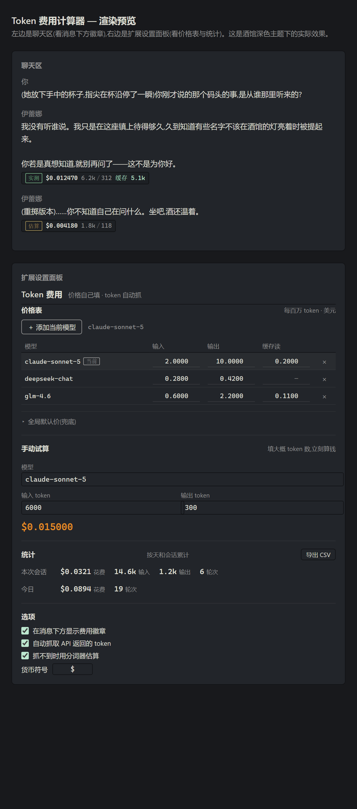

# Token 费用计算器 · SillyTavern / TauriTavern 扩展

一个给酒馆用的 **token 计费扩展**：你自己填模型单价，扩展负责抓「当前这一轮」的 token 用量，实时算出这轮花了多少钱。

**价格全部由你自己填**，不内置任何官方价表 —— 少一层数据维护、少一层过期风险，填一次长期有效。

同时支持 **SillyTavern（酒馆）** 和 **TauriTavern（TT）**：两边扩展目录、manifest 格式、资源路径完全兼容，一份代码两处都能装。



---

## 安装

### SillyTavern（酒馆）

扩展面板 → 「安装扩展」→ 选择「从 URL 安装」→ 粘贴仓库地址：

```
https://github.com/yye18607-maker/sillytavern-token-cost
```

### TauriTavern（TT）

应用内「扩展」→ 安装扩展 → 同样粘贴上面的仓库地址即可。

> 仓库必须是**公开**的（TT 的安装器只接受匿名 Git remote，不支持 private 认证；酒馆同理）。
> 装完之后扩展目录里就是完整的仓库内容，后续还能在面板里直接「检查更新」。

---

## 功能

### 价格：按模型自己填

| 模型 | 输入价 $/1M | 输出价 $/1M | 缓存读价 $/1M |
|---|---|---|---|
| claude-sonnet-5 | 2.00 | 10.00 | 0.20 |
| deepseek-chat | 0.28 | 0.42 | — |
| glm-4.6 | 0.60 | 2.20 | 0.11 |

- 价格**按模型记住**，换个模型自动带出上次填的价
- 新模型留空，自己填；也可以设一个**全局默认价**兜底
- 缓存读价不填时按输入价计（保守估计）

### token：自动抓 + 手动填，两种都留

- **每条 AI 消息下方**显示费用徽章：花费、输入/输出 token、缓存命中、数据来源
- **设置面板**里可以手填 token 立刻试算（还没发出去时预估、跟账单对账都行）
- **统计**：本次会话 / 今日累计花费与 token
- **导出 CSV** 对账

### 数据来源优先级

```
① API 返回的 cost（账单真值，蓝灰）
   ↓ 没有
② API 返回的 usage token（实测，绿）
   ↓ 没有
③ 酒馆分词器估算（暗黄）
   ↓
④ 你手动填的数字（橙）
```

UI 上用颜色标签区分来源，一眼看得出这个数可不可信。

### 算费公式

```
费用 = (未命中输入 × 输入价
      + 命中缓存输入 × 缓存读价
      + 输出 × 输出价
      + 缓存写入 × 缓存写价) ÷ 1,000,000
```

---

## 兼容性说明

- 纯前端扩展，**不需要 Node 后端插件**（TT 明确不支持 Node 后端插件）
- 抓 token 的方式是 hook `window.fetch` + `response.clone()` 旁路读取，**不会消费掉原始流**（聊天不会卡）
- 同时认 OpenAI / Anthropic / Gemini / 部分中转四套 usage 字段形状
- 计费明细写进 `message.extra.tokenCost`，**随聊天文件保存，换设备也在**

### 已知限制

- **SillyTavern 全仓不发送 `stream_options.include_usage`**，所以走 OpenAI 官方直连时流里没有 usage，只能落到分词器估算（徽章标「估算」）。想拿「实测」需要用会返回 usage 的中转。
- 酒馆每条新消息都改上下文，**前缀缓存天然难命中**，多数场景缓存 token 为 0。
- Anthropic 写缓存收 1.25× 输入费，命中率低于约 22% 时开缓存反而更亏。

---

## 开发

```bash
node test-logic.mjs          # 纯逻辑单测（价格归一化、算费、usage 合并等）
node test-integration.mjs    # 模拟酒馆环境跑扩展主流程
node test-api-contract.mjs   # 对着 SillyTavern 源码校验 API 契约（需要一份 ST 源码在旁）
```

三个脚本都只依赖 Node，不需要装酒馆本体。

## License

MIT
